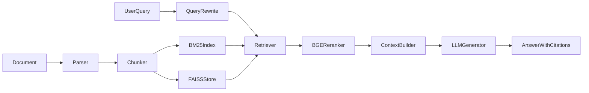

# Minimal RAG

本地 Minimal RAG：文档解析、层级+语义分块、BM25+FAISS 混合检索、Query 改写、Rerank、上下文组装与带引用生成。

## 端到端链路

```
文档解析 → 清洗分块 → 构建混合索引（BM25 + 向量）
       → Query 增强 → 多路召回 → Rerank 融合
       → 上下文拼接 → LLM 生成 + 引用溯源
```



## 目录结构

```
simpleRag/
├── config/settings.py       # 模型、分块、topk、路径
├── core/
│   ├── document_parser.py   # txt / md / pdf（pypdfium2）
│   ├── chunker.py           # 标题优先 + 语义分块 + overlap
│   ├── embedder.py          # Embedding（DashScope / OpenAI / local）
│   ├── db.py                # SQLite：BM25 倒排 / chunk 语料
│   ├── bm25_index.py        # BM25（倒排落 SQLite）
│   ├── vector_store.py      # FAISS 向量索引
│   ├── query_rewrite.py     # LLM 改写 + 关键词
│   ├── retriever.py         # 多路召回编排
│   ├── reranker.py          # Rerank（DashScope / local / HF）
│   ├── context_builder.py   # 长度截断 + 来源标注
│   ├── llm_generator.py     # Chat Completions
│   └── pipeline.py          # 建索引 / 问答编排
├── api/main.py              # FastAPI：upload / ask
├── eval/ragas_eval.py       # Hit Rate、Recall@k、Ragas
├── demo.py                  # 命令行一键跑通
├── data/sample/             # 样例文档
└── storage/
    ├── rag.db               # SQLite：倒排 + chunk
    └── faiss/               # FAISS：faiss.index + meta
```

## 核心设计

### 1. 分块：层级优先 + 语义分块

固定大小分块容易把完整语义切两半。本项目：

1. 优先按标题（Markdown `#` / PDF 启发式标题）切 section，保证语义边界  
2. section 超长时，对句子做 embedding，在相似度低谷处切  
3. 块之间保留 overlap，防止上下文割裂  

### 2. 混合索引：BM25 + FAISS

| 通道 | 职责 | 持久化 |
|------|------|--------|
| BM25（jieba + rank_bm25） | 关键词、专有名词 | SQLite `storage/rag.db`（`inverted` 倒排表） |
| FAISS（IndexFlatIP + L2 归一化） | 语义召回 | `storage/faiss/faiss.index` |

两路分开构建、分开检索；启动时从库/文件加载到内存再检索。

### 3. 融合策略

```
query → 改写得到多个 query
     → 分别走 BM25 / 向量 top-k
     → 按 chunk_id 去重合并候选
     → Rerank 统一打分
     → 取 topN（最终顺序由 rerank 决定）
```

### 4. Query 改写

短问、模糊问会导致召回不足。用 LLM 扩成 2 个侧重点不同的等价查询，并抽关键词，扩大召回面。

### 5. 上下文与防幻觉

- 按字符预算截断，优先高分 chunk  
- 每段带 `[来源：文件，块id]`  
- System prompt：只基于材料作答；没有就说找不到；标注 `[1][2]`  

### 6. 模型切换

- **LLM**：OpenAI 兼容接口（DeepSeek / Ollama / 通义 / vLLM），改 `OPENAI_BASE_URL` + `LLM_MODEL`
- **Embedding / Rerank**：默认阿里云百炼/千问（`DASHSCOPE_API_KEY` + `text-embedding-v3` / `qwen3-rerank`）；也可 `local` 本机 BGE 或 `hf` 远程

## 快速开始

```bash
# 1. 环境
cd simpleRag
python -m venv .venv
# Windows:
.venv\Scripts\activate
pip install -r requirements.txt

# 2. 配置
copy .env.example .env
# 编辑 .env：填入 OPENAI_API_KEY、DASHSCOPE_API_KEY 等

# 3. 命令行 Demo
python demo.py
# 或单次问答
python demo.py --once "什么是RAG？"
# 强制重建索引
python demo.py --rebuild

# 4. API
uvicorn api.main:app --reload --port 8000
# POST /upload  上传文件
# POST /ask     {"query":"..."}
# GET  /health

# 5. 评估
python eval/ragas_eval.py --skip-ragas   # 仅检索指标
python eval/ragas_eval.py                # + Ragas 生成指标
```

### Ollama 示例（仅 LLM）

```env
OPENAI_API_KEY=ollama
OPENAI_BASE_URL=http://localhost:11434/v1
LLM_MODEL=qwen2.5:7b
```

Embedding / Rerank 仍建议使用 DashScope，或改 `EMBEDDING_PROVIDER=local` / `RERANKER_PROVIDER=local`。

## 评估指标

| 类型 | 指标 | 含义 |
|------|------|------|
| 检索 | Hit Rate | top-k 是否命中相关内容 |
| 检索 | Recall@k | 相关关键词在 top-k 中的覆盖率 |
| 生成 | Answer Relevancy | 答案与问题相关程度（Ragas） |
| 生成 | Faithfulness | 答案是否忠实于检索上下文（幻觉） |

测试集：[`eval/sample_testset.json`](eval/sample_testset.json)。报告写入 `storage/eval_report.json`。

## 局限

- **无 OCR**：扫描件 PDF 暂不支持，后续可接 PaddleOCR / 云 OCR  
- **索引更新**：上传后对 SQLite 倒排 + FAISS 做简单全量重建，非细粒度增量/删除版本管理  
- **FAISS Flat**：适合中小规模本地 Demo；更大规模需 IVF/HNSW 与分片  
- **Rerank 成本**：远端 API 或本地 Cross-Encoder 均有延迟与费用考量  
- **语义分块**：依赖 embedding 质量与阈值；无 API 时退化为按句打包  

## API 示例

```bash
curl -F "file=@data/sample/rag_intro.md" http://127.0.0.1:8000/upload

curl -X POST http://127.0.0.1:8000/ask \
  -H "Content-Type: application/json" \
  -d "{\"query\": \"为什么需要混合检索？\"}"
```
